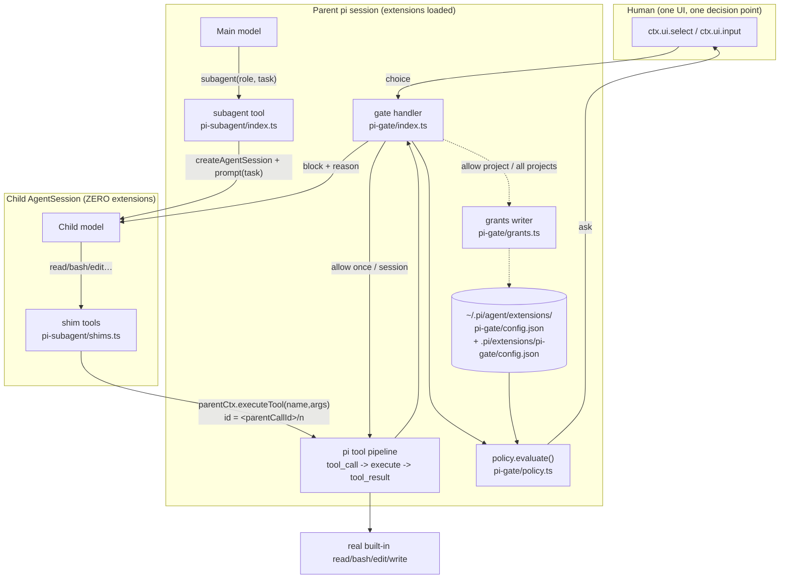
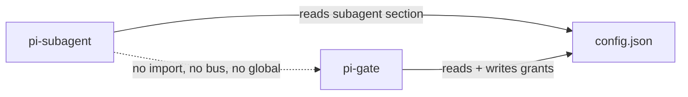
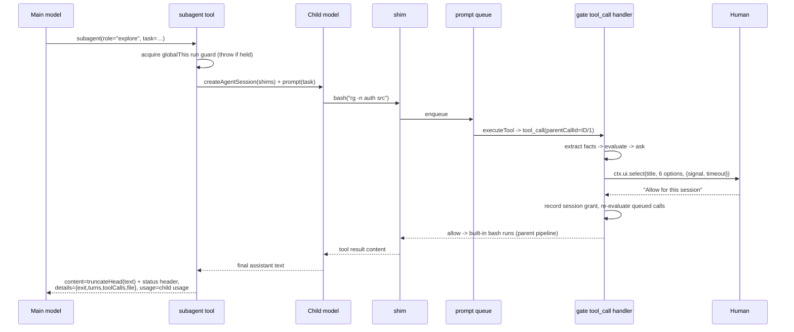

# ARCHITECTURE_PLAN_pi-sub-gate — a blocking `subagent` tool + a multi-scope permission gate for pi

## Summary

Two independent pi extensions in one repo — `pi-gate` (permission gate) and `pi-subagent` (single
blocking delegation tool) — designed to compose like `@gotgenes/pi-permission-system` +
`@gotgenes/pi-subagents` but at a fraction of the size, by deleting the entire cross-process
permission-forwarding apparatus. The trick: the child `AgentSession` loads **zero extensions** and
its tools are **shims that call the parent's `ExtensionToolContext.executeTool()`**, so every
subagent tool call is executed inside the *parent's* tool pipeline. The parent's `tool_call`
handlers fire (`parentToolCallId` = `<subagentCallId>/<n>`), the parent's single config decides, the
parent's single `ctx.ui.select()` prompts, and a denial reason is delivered to the child's model as
an `isError` tool result. `pi-permission-system`'s 26 KB forwarding/heartbeat/inbox spec becomes zero
lines. Grant scopes come from `pi-sandbox`: **Abort / Abort with reason / Allow once / Allow this
session / Allow this project / Allow all projects**, with `abort with reason` piping the human's
verbatim instruction back to the model. The two extensions share exactly one artifact — a config
file — and no module, event bus, or global.

### Verified API ground truth (all `[VERIFIED]` against the installed SDK)

Root `P = /media/jang/home/PortableApp/node/profile/npm-global/lib/node_modules/@earendil-works/pi-coding-agent`

| # | Fact | Citation |
|---|---|---|
| A1 | `ExtensionToolContext.executeTool(name, args, opts)` runs a tool "through the same validation, hooks, and **permission checks** as model-issued calls"; `tool_call`/`tool_result`/`tool_execution_*` carry `parentToolCallId` | `P/dist/core/extensions/types.d.ts:269-283` |
| A2 | Nested call ids are `<callerId>/<n>`; blocked calls, unknown tools and throws all come back as `isError: true` (never a rejection) | `types.d.ts:929-936`, `P/dist/core/nested-tool-calls.d.ts:96-101` |
| A3 | `tool_call` may return `{ block, reason, terminate }`; `event.input` mutable; `event.cwd` on the base event | `types.d.ts:920-936, 1089-1097` |
| A4 | **`customTools` override built-in tools by name** — the definition registry is seeded from `_baseToolDefinitions`, then `customTools` are `set()` over it | `P/dist/core/agent-session.js:2881-2896` |
| A5 | `customTools` are filtered by the `tools` allowlist, so every shim name must be listed there | `agent-session.js:2877-2885`, `P/dist/core/sdk.js:157` |
| A6 | A stub `ResourceLoader` (all methods constant) yields a session with **no extensions**; `getSystemPrompt()` fully controls the child prompt | `P/examples/sdk/12-full-control.ts:28-46` |
| A7 | `createAgentSession` defaults `modelRuntime` to `ModelRuntime.create({authPath, modelsPath})` from `agentDir` → child inherits auth/models.json | `sdk.js:75` |
| A8 | `ExtensionUIDialogOptions = { signal?, timeout? }`; `select(title, options, opts) -> Promise<string \| undefined>`; `ctx.hasUI` false in print/json, `ctx.mode = "tui"\|"rpc"\|"json"\|"print"` | `types.d.ts:40-46, 72-84, 212-221` |
| A9 | `AgentToolResult.usage` exists for exactly this case: "if your tool makes a nested LLM call, return its `Usage` here; pi persists it … folds into footer/`/session`/RPC totals" | `types.d.ts`, PI_EXTENSION_SKILL "execute() return value" |
| A10 | `NESTED_CALL_LIMITS.maxCalls = 256` per model-issued call (record only; calls beyond it are dropped from `nestedCalls`) | `nested-tool-calls.d.ts:18-24` |
| A11 | Tool schemas: `bash{command,timeout}`, `read{path,offset?,limit?}`, `write{path,content}`, `edit{path,edits[]}`, `grep{pattern,path?,glob?,…}`, `find{pattern,path?,limit?}`, `ls{path?,limit?}` | `P/dist/core/tools/{bash,read,edit,write,grep,find,ls}.js` |
| A12 | `truncateHead` keeps the **first** N, `truncateTail` keeps the **last** N; limits 50 KB / 2000 lines | `P/dist/core/tools/truncate.d.ts:45-58` |
| A13 | `getAgentDir()`, `CONFIG_DIR_NAME`, `SessionManager.create(cwd, sessionDir)`, `SettingsManager.inMemory(partial)`, `createBashTool` etc. are public exports | `P/dist/index.d.ts:2,21,22,26` |
| A14 | `before_agent_start` fires per run; a child extension registering a tool rebuilds the registry and undoes a one-shot active-tool filter | `types.d.ts:1125-1129`; `gotgenes/pi-packages …/create-subagent-session.ts:11-19` |

### Known-good reference behaviour this plan copies

* `pi-permission-system` — flat `permission` map, surfaces, **last-matching-pattern-wins**, chained
  bash command splitting with most-restrictive-wins, cross-cutting `path` surface, `external_directory`,
  session approvals with a *suggested pattern*, "hides disallowed tools before the agent starts".
  Local evidence of the shipped config shape: `~/.pi/agent/extensions/pi-permission-system/config.json`.
* `pi-sandbox` — the four persistence scopes, session allowances in memory only, "a timeout never grants permission", `enabled` kill switch, `--no-sandbox` flag, footer status indicator.

---

## System boundaries



**Ownership boundary.** `pi-gate` owns policy, prompts, and persistence. `pi-subagent` owns the
child lifecycle. Neither imports the other. Coupling is limited to (a) one config file path and
(b) pi's own active-tool registry: because `pi-gate` removes fully-denied tools from the parent's
declared set, and the child's tool set is derived from `ctx.tools` (the parent's callable set),
**gate filtering reaches the child for free** with no bespoke API — the reason the first draft's
`service.ts` was deleted after red-teaming.



---

## Data flow: one gated subagent call



### State management

| State | Home | Lifetime | Written by |
|---|---|---|---|
| `Policy` (ordered rule list) | `pi-gate/policy.ts` module var, mtime-invalidated | process, reloaded on file change + `/gate reload` | config files |
| session grants | `SessionGrants` Map in `pi-gate/grants.ts` | `session_start` → `session_shutdown`; **never persisted**, cleared by `/reload` | dialog |
| project / global grants | `grants.project` / `grants.global` keys of each scope's `config.json` | forever, until `/gate reset grants` | `grants.appendGrant()` |
| observed subagent calls (`callId → {role, task}`) | `Map` in `pi-gate/index.ts`, capped at 64 entries | session | own `tool_call` observation |
| run guard | `globalThis[Symbol.for("pi-subagent.run")]` | process (survives `/reload`) | `pi-subagent/index.ts` |
| child transcript | `<parentSessionDir>/subagent/<childId>.jsonl` | last 20, pruned per run | pi's `SessionManager` |

Deliberate: **no extension state lives in the session transcript.** The child transcript is written
by pi itself and is for human audit only; neither extension reconstructs state from
`sessionManager.getBranch()`, so `/resume` and `/tree` cannot desync them.

### Evaluation semantics (the single source of truth)

Two distinct rules, and conflating them is what made draft v2 look self-contradictory:

1. **Within one fact** (one surface + one value, e.g. the bash segment `git push origin main`
   against surface `bash`): all layers concatenate in precedence order
   `builtin → global.permission → project.permission → grants.global → grants.project → grants.session`
   and the **last matching pattern wins**. This is what lets a project or session `allow` override a
   global `ask`.
2. **Across the facts of one call** (bash segments ×0..n, paths ×0..n, the tool surface, `path`,
   `external_directory`): **most restrictive wins**, `deny > ask > allow`.
3. **Floors, applied after both rules:**
   * `PROTECTED_PATHS` (`~/.pi/agent/**`, `<cwd>/.pi/extensions/**`, `.git/hooks/**`) ⇒ minimum `ask`,
     never satisfiable by any `allow` rule or grant. A *floor*, not a deny — the human can still
     approve editing their own configs, which is a routine part of this user's workflow.
   * Wrapper / expansion floor: a segment that is wrapped (`sudo`, `env`, `sh -c`, `bash -c`, `zsh -c`,
     `eval`, `timeout N`, `command`, `exec`, `nohup`, `xargs`, `doas`, `pkexec`, `su`, `npx`, `dlx`,
     `uvx`, `watch`) or contains an unparsed expansion (`$(`, `` ` ``, `<(`, `>(`) ⇒ `allow` escalates to `ask`.
   * `denyWrite`-class hard deny: `path` surface `deny` is never overridden by a per-tool `allow`
     (copied from pi-permission-system; it is the whole point of a cross-cutting surface).
4. No match anywhere ⇒ `permission["*"]` ⇒ default `ask` (pi-permission-system parity: "Omitting `\"*\"`
   defaults to `ask` (least privilege)").

---

## Implementation Blueprint

Paths are **install-relative**; see step 1 for where they live in this repo and how they reach
`~/.pi/agent/extensions/`. Type-only imports come from `@earendil-works/pi-coding-agent`
(`ExtensionAPI`, `ExtensionContext`, `ExtensionToolContext`, `ToolDefinition`, `AgentTool`,
`ResourceLoader`, `Model`, `Usage`), schemas from `@sinclair/typebox`, `StringEnum` from
`@earendil-works/pi-ai`.

| # | File path | Action | Concrete signature / schema (pseudocode) | Depends on | Acceptance criteria ("done when…") |
|---|---|---|---|---|---|
| 1 | `pi-gate/index.ts`, `pi-subagent/index.ts`, `package.json` | create | scaffold: `package.json` `{ "peerDependencies": { "@earendil-works/pi-coding-agent": "*", "@earendil-works/pi-ai": "*", "@sinclair/typebox": "*" } }`; both entries export `export default function (pi: ExtensionAPI) {}` | — | `pi -e ./pi-gate/index.ts -p "hi"` loads with no extension errors and `/reload` is silent |
| 2 | `pi-gate/schema.ts` | create | `type Action="allow"\|"ask"\|"deny"`; `type Scope="builtin"\|"global"\|"project"\|"grants.global"\|"grants.project"\|"grants.session"`; `interface GateConfig{enabled:boolean; reviewLog:boolean; promptTimeoutMs:number; permission:Record<string, Action \| Record<string,Action>>}`; `interface SubagentLimits{maxTurns:number; timeoutMinutes:number; maxResultBytes:number; keepTranscripts:number}`; `parseGateConfig(raw:unknown, where:string):{config:Partial<GateConfig>; errors:string[]}`; `parseSubagentConfig(raw:unknown):{limits:Partial<SubagentLimits>; errors:string[]}`; `DEFAULT_GATE_CONFIG:GateConfig`; `DEFAULT_SUBAGENT_LIMITS:SubagentLimits` | 1 | Unit test: valid doc parses; a surface whose value is neither string nor object yields an entry in `errors` and contributes **no rule**; `DEFAULT_GATE_CONFIG` matches the shipped default block below |
| 3 | `pi-gate/match.ts` | create | `wildcardMatch(pattern:string, value:string):boolean` (`*`=any chars incl `/`, `?`=one char, `~`/`$HOME` expanded); `pathSpellings(p:string, cwd:string):string[]` (lexical, cwd-absolute, `realpath` of nearest existing ancestor, `..`-resolved, trailing-slash normalised); `segmentCommands(command:string):string[]` (quote-aware split on `&& \|\| ; \| &` and newline; heredoc bodies and `\`-continuations handled; **the only seam for a future real parser**); `peelEnvPrefix(seg:string):{command:string; stripped:string[]}`; `hasUnparsedExpansion(seg:string):boolean`; `isWrappedSegment(seg:string):boolean`; `suggestBashPattern(seg:string, persisted:boolean):string`; `BASH_ARITY:Record<string,number>` (git, npm, pnpm, yarn, bun, go, cargo, docker, pip, uv, gh, kubectl, apt, brew — default 1); `PROTECTED_PATH_GLOBS:readonly string[]` | 1 | `segmentCommands("cd /a && rm -rf b \|\| echo hi") → 3 segments`; `segmentCommands("echo 'a && b'") → 1`; `isWrappedSegment("/usr/bin/sudo ls")===true`; `isWrappedSegment("echo \\$(rm x)")===false && hasUnparsedExpansion(...)===true`; `suggestBashPattern("git status --short", true)==="git status --short"` and `…, false)==="git status *"` |
| 4 | `pi-gate/inspect.ts` | create | `interface Facts{toolName:string; callId:string; parentCallId?:string; cwd:string; surfaces:Array<[surface:string, values:string[]]>; paths:string[]; preview:string}`; `type Extractor=(input:Record<string,unknown>, cwd:string)=>{surfaces:Array<[string,string[]]>; paths:string[]}`; `EXTRACTORS:Record<string,Extractor>` keyed `bash read write edit grep find ls`; `defaultExtractor(input,cwd):{surfaces; paths}` (scans param names `path file dir cwd`, else `paths:[]`); `extract(toolName:string, input:Record<string,unknown>, cwd:string):Facts` | 2, 3 | For `bash{command:"cat /etc/hosts > .env"}` facts contain: surface `bash` with both segments, and `paths` containing the absolute spelling of both `/etc/hosts` and `.env` (redirect target extraction). For `read{path:"src/a.ts"}`: surface `read`, `paths=[<abs>]`. For an unknown MCP tool: surface = tool name, `paths` from param scan |
| 5 | `pi-gate/policy.ts` | create | `interface Rule{surface:string; pattern:string; action:Action; scope:Scope; origin:"policy"\|"grant"}`; `interface Policy{rules:Rule[]; files:string[]; invalidScopes:Scope[]}`; `loadPolicy(cwd:string, trusted:boolean):Policy` (reads global then project file, mtime-cached); `withSessionGrants(p:Policy, g:SessionGrants):Policy`; `evaluate(f:Facts, p:Policy):Decision`; `interface Decision{action:Action; reason?:string; matched?:Rule; grant?:GrantOffer; facts:Facts}`; `interface GrantOffer{surface:string; pattern:string; label:string; persisted:boolean}`; `isFullyDenied(toolName:string, p:Policy):boolean`; `resolveConfigPaths(cwd:string, trusted:boolean):{globalFile:string; projectFile:string\|null}` | 2, 3, 4 | Given global `bash{"*":"ask","git *":"allow"}` + project `bash{"git push *":"deny"}`: `git push` → `deny`; `git status` → `allow`; `rm x` → `ask`. `isFullyDenied("bash", {bash:"deny"})===true`, `isFullyDenied("bash", {bash:{"*":"deny","git *":"ask"}})===false`. Untrusted cwd ⇒ `projectFile===null` and no project rule in `Policy.rules` |
| 6 | `pi-gate/grants.ts` | create | `createSessionGrants():SessionGrants` (`Map<surface, Array<{pattern,action,scope}>>`); `appendSession(g:GrantOffer):void`; `clearSession():void`; `appendPersisted(g:GrantOffer, cwd:string):Promise<{ok:boolean; file:string; error?:string}>` — scope `project` → `grants.project` in `<cwd>/.pi/extensions/pi-gate/config.json`, scope `global` → `grants.global` in `~/.pi/agent/extensions/pi-gate/config.json`; read-modify-write with re-read before write, temp file + `rename`; `resetPersisted(kind:"project"\|"global", cwd:string):Promise<boolean>` | 2, 5 | Two sequential calls with different patterns leave **both** in the file; a hand-written `// comment` elsewhere in `config.json` is reported as lost-and-warned (documented trade-off, see FM-9) — test asserts the JSON stays valid and re-readable; concurrent call from a second process is resolved by re-read+merge (test with two `appendPersisted` in `Promise.all`) |
| 7 | `pi-gate/prompt.ts` | create | `type Choice="once"\|"session"\|"project"\|"global"\|"abort"\|"abort_reason"`; `const CHOICES:Choice[]` index-aligned with `optionLabels(d:Decision):string[]`; `ask(ctx:ExtensionContext, d:Decision, signal?:AbortSignal):Promise<{choice:Choice; reason?:string}>`; `dialogTitle(d:Decision, sub?:{role:string; task:string}):string` | 5, 6 | Labels are exactly: `Allow once` / `Allow "<grant.pattern>" for this session` / `… for this project (<cwd>)` / `… for all projects` / `Abort` / `Abort with reason…`. `select` resolving `undefined` (Esc, dismiss, timeout) ⇒ `{choice:"abort"}` — never an allow. `abort_reason` chains exactly one `ctx.ui.input("What should the agent do instead?")`; empty input ⇒ falls back to plain `abort` |
| 8 | `pi-gate/index.ts` | create | default export `function (pi: ExtensionAPI)` registering: `pi.registerFlag("no-gate",{type:"boolean",default:false})`; `pi.on("session_start")` → load policy, notify errors, footer `ctx.ui.setStatus("gate", …)`; `pi.on("tool_call", async (e,ctx))` → `const f=extract(e.toolName,e.input,e.cwd); const d=evaluate(f, policy); if ask → ask(); map choice→allow/block; if deny → {block:true, reason}`; records `subagent` calls in `observed:Map<string,{role,task}>`; `pi.on("before_agent_start")` → `pi.setActiveTools(recomputeActive(pi.getAllTools().map(t=>t.name), policy))`; `pi.on("session_shutdown")` → `clearSession()`; `pi.registerCommand("gate",{handler})` subcommands `status \| grants \| reload \| reset grants [project\|global] \| off \| on` | 5, 6, 7 | A `bash` call matching an `ask` rule blocks until answered; choosing **Abort with reason** makes the model receive the typed text verbatim in the tool result; a handler that throws mid-evaluation ⇒ `{block:true, reason:"[gate] internal error …"}` (fail closed, verified by a test that injects a throwing extractor); `--no-gate` ⇒ handler returns immediately and footer shows `gate off` |
| 9 | `pi-gate/index.ts` (grants→policy loop) | modify | after a session/project/global grant is recorded: `policy = withSessionGrants(loadPolicy(…), g)` and re-run `before_agent_start` tool recomputation | 5, 6, 8 | Approving `git *` for the session means the next `git commit -m x` in the same turn is **not** re-prompted, and `ctx.getActiveTools()` reflects a tool that was hidden and is now permitted |
| 10 | `pi-subagent/roles.ts` | create | `type RoleName="explore"\|"general-purpose"\|"review"`; `interface Role{name:RoleName; description:string; prompt:string; allowTools:readonly string[]; maxTurns:number; timeoutMinutes:number}`; `ROLES:Record<RoleName,Role>`; `ROLE_ORDER:readonly RoleName[]`; `resolveRole(input:string):Role\|undefined`. Values: `explore` → `allowTools:["read","grep","find","ls","bash"]`, `maxTurns 20`, `10 min`; `review` → same five tools, `maxTurns 15`, `10 min`; `general-purpose` → `allowTools:["*"]`, `maxTurns 40`, `20 min` | 1 | `resolveRole("Explore")` (case/space tolerant) returns the role; `resolveRole("nope")` returns `undefined`; no user-editable role config exists anywhere |
| 11 | `pi-subagent/prompt.ts` | create | `buildChildSystemPrompt(role:Role, cwd:string):string` — fixed text: role line, `cwd`, "you are a subagent: no conversation history, one shot, answer completely, do not delegate", ≤120 words, **no tool list** (pi renders tools separately) | 10 | Prompt token count ≤ 220 tokens (measured with `--mode json` + `before_provider_request` log dump); contains no `~/.pi` absolute paths |
| 12 | `pi-subagent/shims.ts` | create | `interface ShimHost{parentCallId:string; executeTool:ExtensionToolContext["executeTool"]}`; `buildShims(tools:readonly AgentTool[], role:Role, host:ShimHost, limit:SubagentLimits):ToolDefinition[]` — one shim per allowed tool, **copying `name`, `description`, `parameters` verbatim**, `execute:(id,args,signal,onUpdate)=>enqueue(()=>host.executeTool(name,args,{signal,onUpdate}))`, `executionMode:"sequential"`; `createQueue():<T>(fn:()=>Promise<T>)=>Promise<T>` (module-level, single tail promise); `isDeniedByLimit(name:string, limits:SubagentLimits):boolean` | 10 | Child calling `read` on a gate-denied path receives an `isError` result whose text contains the gate's reason (proves A1+A4 end-to-end, i.e. no ungated built-in ran); two parallel child calls produce strictly serialised `executeTool` invocations (asserted by interleaving logger in a test) |
| 13 | `pi-subagent/child.ts` | create | `interface ChildRunInput{role:Role; task:string; cwd:string; agentDir:string; model:Model; tools:ToolDefinition[]; sessionDir:string; signal:AbortSignal; onProgress:(s:RunProgress)=>void; sessionFactory?:(o:CreateAgentSessionOptions)=>Promise<{session:AgentSession}>}`; `interface RunProgress{turns:number; toolCalls:number; lastTool?:string; elapsedMs:number}`; `type Exit="done"\|"aborted"\|"maxTurns"\|"timeout"\|"callLimit"\|"overflow"\|"error"`; `interface ChildResult{text:string; exit:Exit; turns:number; toolCalls:number; childSessionFile?:string; usage?:Usage; error?:string}`; `runChild(i:ChildRunInput):Promise<ChildResult>`; `makeNullLoader(promptText:string, systemPrompt:string):ResourceLoader` (stub shaped exactly like A6); `pruneTranscripts(dir:string, keep:number):Promise<number>` | 11, 12 | `runChild` on a stub model returns `exit:"done"`, non-empty `text`, a real `childSessionFile` on disk; `signal.abort()` mid-run returns `exit:"aborted"` in <1 s and `session.dispose()` was called (assert with a spy); `Promise.race` guarantees it settles even if `prompt()` never resolves |
| 14 | `pi-subagent/child.ts` (assembly detail) | create | inside `runChild`: `createAgentSession({ cwd, agentDir, model, tools: shims.map(t=>t.name), customTools: shims, resourceLoader: makeNullLoader(...), sessionManager: SessionManager.create(cwd, join(sessionDir,"subagent")), settingsManager: SettingsManager.inMemory({compaction:{enabled:false}, retry:{enabled:false}}), thinkingLevel })` — **`tools` must list every shim name** (A5); recursion guard = `subagent` never present in `ctx.tools`-derived shims, asserted by `if (name==="subagent") continue` | 13 | Child `getActiveToolNames()` equals the shim names exactly; a built-in `bash` is *not* reachable in the child (call `bash` in the child and assert the shim ran, e.g. by a marker file written once) |
| 15 | `pi-subagent/index.ts` | create | default export registers **one** tool: `name:"subagent"`, `parameters: Type.Object({ role: StringEnum([...ROLE_ORDER]) , task: Type.String({description:"Self-contained brief; include file paths in the text"}) })`, `executionMode:"sequential"`, `promptSnippet:"Run a one-shot subagent with an isolated context"`, `promptGuidelines:["Use subagent for open-ended search or review; the call blocks until it finishes","subagent(role, task) — role: explore (read-only survey), general-purpose (full tools), review (critique only)"]` (≤2 bullets, ≤160 chars total); `execute` = run-guard → limits from `pi.getSettings()`-independent `subagent` config section → `buildShims(ctx.tools, role, host, limits)` → `runChild` → `AgentToolResult{content:[status header + truncateHead(text,{maxBytes:limits.maxResultBytes})], details:{role,childSessionFile,childSessionId,turns,toolCalls,exit,truncated}, usage:result.usage}`; `pi.on("session_shutdown")` aborts+disposes the live child | 10, 12, 13, 14 | Second concurrent call throws `"one subagent at a time"`; after `/reload` the guard is still held (it lives on `globalThis[Symbol.for("pi-subagent.run")]`); result `details.childSessionFile` exists and contains the child's tool calls; the footer token total increases by the child's usage (A9) |
| 16 | `pi-subagent/index.ts` (progress) | modify | inside `execute`: `onUpdate?.({content:[{type:"text",text:formatProgress(p)}], details:{…}})` on every `tool_execution_*`-derived tick (≥1 s apart) | 15 | A ≥3-tool-call run shows a live `turn 4 · 7 calls · bash · 22s` line in the tool shell rather than a frozen spinner |
| 17 | `config.json` (install data) | create | shipped default (see block below this table): `gate` section + `subagent` section | 2, 5, 15 | With the file absent the pair still works from `DEFAULT_GATE_CONFIG` + `DEFAULT_SUBAGENT_LIMITS` and notifies once that defaults are in use |
| 18 | `pi-gate/log.ts` | create | `reviewLog(path:string, e:LogEntry):void` (`appendFile`, JSON line); `interface LogEntry{ts:string; callId:string; parentCallId?:string; toolName:string; surface:string; pattern?:string; scope?:Scope; resolution:string; reason?:string; sub?:{role:string; taskExcerpt:string}}`; path `~/.pi/agent/extensions/pi-gate/logs/review.jsonl`, `reviewLog:false` by default | 5, 8 | Log line count increases by exactly 1 per `ask` resolution; `redact(s:string):string` masks `token\|secret\|password\|KEY=` values (unit-tested) because bash commands carry credentials |
| 19 | `pi-gate/config-file.ts` | create | `readConfigFile(file:string):{json:unknown; mtimeMs:number; error?:string}` (shared by both extensions' loaders — **pure data, no state, no gate imports**); `getGlobalConfigFile():string` = `join(getAgentDir(),"extensions","pi-gate","config.json")` (honours `PI_CODING_AGENT_DIR`, A13) | 2 | Works with no `pi-gate` present (used by `pi-subagent` alone) |
| 20 | `pi-subagent/config-file.ts` | create | `loadSubagentLimits(cwd:string, trusted:boolean):SubagentLimits` — same two file scopes as the gate, `subagent` key only, own 20-line reader (intentional duplication: keeps `pi-subagent` import-free of `pi-gate`) | 2, 19 | Deleting `pi-gate` entirely leaves `subagent` working with limits from the same config file |
| 21 | `pi-gate/__tests__/policy.test.ts`, `match.test.ts`, `pi-subagent/__tests__/shims.test.ts` | create | pure-function tests for every criterion above; `runChild` tested against a stubbed `createAgentSession` injected via `ChildRunInput.sessionFactory?: (o: CreateAgentSessionOptions) => Promise<{ session: AgentSession }>` (the only test seam in `child.ts`). Runner: `vitest` (`devDependencies`, no `dependencies` — pi's package install drops devDeps at runtime, per `PI_EXTENSION_SKILL.md`); test files import the plain TS modules directly, never `index.ts` | 3, 5, 12, 13 | `npm test` green; no test requires a live provider |
| 22 | `<repo>/config-pi/extensions/{pi-gate,pi-subagent}/…` + `<repo>/config.json` | modify | add `"dirs": ["extensions"]` to the `pi` tool entry in `config.json:18-23` (mirroring the `opencode`/`kilocode` entries at `config.json:9,16`) so `zen-ai restore` installs both extensions via `internal/zenai/restore.go::Restore` + `fsutil.go::copyDir`; drop the now-conflicting `"npm:@gotgenes/pi-permission-system"` from `config-pi/settings.json:12` | all above | `zen-ai restore pi` puts both dirs under `~/.pi/agent/extensions/`; `pi` starts with **exactly one** gate prompt per gated call (double-gating with the old package is the regression to test for) |

### Shipped default config (step 17)

```jsonc
// ~/.pi/agent/extensions/pi-gate/config.json
{
  "gate": {
    "enabled": true,
    "reviewLog": false,
    "promptTimeoutMs": 0,
    "permission": {
      "*": "ask",
      "read": "allow",
      "grep": "allow",
      "find": "allow",
      "ls": "allow",
      "path": {
        "*": "allow",
        "*.env": "deny",
        "*.env.*": "deny",
        "*.env.example": "allow",
        "*.pem": "deny",
        "*.key": "deny",
        "*id_rsa*": "deny"
      },
      "external_directory": "ask",
      "bash": { "*": "ask" }
    }
  },
  "subagent": {
    "maxTurns": 30, "timeoutMinutes": 20,
    "maxResultBytes": 20000, "keepTranscripts": 20
  }
}
```

`grants.session` is never present in a file. `grants.project` / `grants.global` are written by step 6
under the same `gate` object.

---

## Failure modes

| ID | Failure | Guard (file · symbol) |
|---|---|---|
| FM-1 | Child reaches a **real built-in tool** and runs ungated (total design failure) | A4 guarantees `customTools` override; asserted by step 14's marker-file test and step 12's denied-`read` test. If it ever fails, `pi-subagent/shims.ts::buildShims` throws at build time when a shim name is absent from the child's registry |
| FM-2 | Subagent tool never returns → parent hangs forever | `child.ts::runChild` `Promise.race([prompt, timeout, abortSignal])`; hard `timeoutMinutes + 60 s` ceiling; `session.dispose()` in `finally` (step 13) |
| FM-3 | Orphaned `bash` process after Esc | `shims.ts` forwards the per-call `signal` into `executeTool` (A1 `ExecuteToolOptions.signal`); `child.ts` awaits `session.abort()` with a 5 s bound, then disposes anyway |
| FM-4 | Two prompts open at once, one silently lost | `shims.ts::createQueue()` serialises all child tool calls through one queue; policy **re-evaluated after dequeue** so a grant from prompt 1 covers queued call 2 without asking again |
| FM-5 | Gate handler throws → call proceeds unguarded | `pi-gate/index.ts` wraps the whole handler in `try/catch` returning `{block:true, reason:"[gate] internal error: …"}` — fail closed, per `PI_EXTENSION_SKILL.md` ("fail closed … rather than letting an unexpected throw skip your safety check") (step 8, FM test) |
| FM-6 | Untrusted repo ships a `.pi/extensions/pi-gate/config.json` that loosens global policy | `policy.ts::loadPolicy` takes `trusted` from `ctx.isProjectTrusted()` (A14 in pi docs) and ignores the project file when false; `enabled` is read from the **global file only**, so a project cannot switch the gate off; `PROTECTED_PATH_GLOBS` floor is a `const` in `match.ts` that no layer can override (steps 5, 8) |
| FM-7 | Model edits the gate's own config to free itself | same `PROTECTED_PATH_GLOBS` floor: `~/.pi/agent/**` and `<cwd>/.pi/extensions/**` can never resolve below `ask`, not even with an existing session grant (steps 3, 5) |
| FM-8 | `echo $(rm -rf x)` passes an `echo *` allow | `match.ts::hasUnparsedExpansion` + `isWrappedSegment` escalation floor (rule 3 of evaluation semantics); the segment is always shown verbatim in the dialog title (steps 3, 7) |
| FM-9 | Concurrent `pi` instances corrupt the grants file | `grants.ts::appendPersisted` re-reads before writing and writes temp+rename (step 6); parse failure of a **grants** section drops only grants and notifies — it never floors the whole policy (unlike a hand-written `permission` scope, which floors `allow→ask` on invalid, copied from pi-permission-system) |
| FM-10 | `allow` grant suggested is far wider than the call (`pnpm *` = arbitrary code exec committed to git) | `suggestBashPattern(seg, persisted=true)` returns the **exact command** for project/global; wildcards only for in-memory session grants (steps 3, 7) |
| FM-11 | Prompt nobody answers | `promptTimeoutMs` default 0 = wait (user-driven); on any timeout/dismiss → `abort`, never allow (A8 + step 7) |
| FM-12 | `pi -p` / `--mode json` has no UI | `ctx.hasUI === false` ⇒ `ask` resolves to `deny` with a reason naming the fix and the suggested allow pattern (step 8). RPC keeps the dialog (pi proxies it) — see OQ-1 |
| FM-13 | Child loops on errors after hitting `NESTED_CALL_LIMITS.maxCalls = 256` (A10) | roles keep `maxTurns × max parallel calls ≤ 200`; `child.ts` watches the result text for the limit marker and returns `exit:"callLimit"` (steps 10, 13) |
| FM-14 | `/reload` mid-run spawns a second concurrent child | run guard stored on `globalThis[Symbol.for("pi-subagent.run")]` (step 15); `session_shutdown` aborts the live child |
| FM-15 | Child transcripts fill the disk | `pruneTranscripts(dir, limits.keepTranscripts)` after each run (step 13) |
| FM-16 | Child context overflow with compaction disabled | `child.ts` subscribes to `message_end`, reads `ctx.getContextUsage()`-equivalent from child messages; past 90 % ⇒ final steer `"Summarise your findings now, no more tool calls."` then `exit:"overflow"` (step 13) |
| FM-17 | Another `tool_call` handler mutates `event.input` **after** the gate, so the approved facts are stale | Documented limitation (load order is not controllable; `types.d.ts` states later handlers see earlier mutations and there is no "last handler" API). Mitigation: the gate registers from `session_start` on the *last* loaded position achievable by being declared last in `settings.packages`, and `reviewLog` records the input it approved so a mismatch is auditable |
| FM-18 | Double gating (old `@gotgenes/pi-permission-system` still installed) | step 22 removes it from `config-pi/settings.json`; the "exactly one prompt per call" test is the acceptance check |

---

## Key decisions & rejected alternatives

| Decision | Rejected alternative | Why rejected |
|---|---|---|
| Child tools are **shims onto the parent's `executeTool`** | (as in `pi-permission-system`) load the permission extension into every child and forward asks through a session-directory inbox + heartbeat | Requires a polling inbox, serving heartbeats, grace windows, four "not draining" states and cross-process registries (≈26 KB of written spec, several files of code) to arrive at one prompt. Shims get it free from A1/A2 |
| One package, two extension dirs, **no shared runtime module** | shared `service.ts` on `globalThis + Symbol.for` | Red-teamed and deleted: the gate already removes denied tools from the parent's *active* set and `ctx.tools` is derived from it, so filtering propagates with zero bespoke API. A global singleton also has to solve reload republishing, duplicate installs writing the same Symbol, and lazy resolution |
| `subagent(role, task)` — two params, roles hardcoded | config-defined roles, per-call `tools`/`model`/`timeout` params | A model-chosen child allowlist is a privilege-escalation primitive; config-driven roles add a dynamic enum and a config surface for no capability gain. Your instruction: "as little parameter as possible to prevent main agent from getting confused". **Revisited after implementation:** `subagent.roles` in the config now edits the built-ins and adds roles, because the objection was to a *model*-supplied list — the model still names a role and nothing else, the table stays human-authored, and `FORBIDDEN_CHILD_TOOLS` plus the parent's own tool set bound it (`roles.ts::applyRoleConfig`) |
| One policy for main agent and subagents | per-role permission overlays applied to nested calls | You chose a3. Cost accepted knowingly: `explore`/`review` are read-only *by tool visibility*, and `bash >` can still write — mitigated only by the `path` surface and the wrapper floor |
| `ctx.ui.select` + `ctx.ui.input` | pi-permission-system's custom inline keybind dialog (`ctx.ui.custom`, hotkey remap table, double-press confirm, `promptMaxRows`) | Your instruction: stay on the standard API so Pendant/RPC front-ends render it. Also deletes ~400 lines and the IME/hotkey config surface |
| Hand-rolled `segmentCommands` + floors | `tree-sitter-bash` / `mvdan/sh-wasm` | A real grammar is the only way to close every substitution/heredoc/brace case, but it is a runtime dependency + parser ownership + a large prompt-free but maintenance-heavy surface. `segmentCommands()` is the single seam to swap it later |
| `"*": "ask"` default | `"*": "allow"` default | An allow-by-default gate is a speed bump that reads as a gate; you can always downgrade in your own file |
| `grants` keys inside `config.json`, written atomically | separate `grants.json` (red-team suggestion) | Kept one file for your "config at multiple levels" requirement (one path per scope to reason about). Accepted cost: machine writes strip JSONC comments from that file — see FM-9, and the mitigation that `permission` is *usually* untouched because grants land in a distinct sub-object |
| Persisted grant suggestion = exact command | arity-wildcard everywhere | `pnpm *`/`go *`/`cargo *`/`npx` = arbitrary exec committed to git from one click |
| `before_agent_start` recomputation of hidden tools | one-shot filter at `session_start` | A14: registry rebuilds undo a one-shot filter |

---

## Red-team critique summary

Source: `zbrowser -a chat -p claude -up draft-v2.md` → `/tmp/zen-mcp/chat/chat-1792922704615.md`.

| Point | Status |
|---|---|
| §0.1 shims may not override built-ins → child ungated | **folded in** (verified false by A4, but promoted to FM-1 with an explicit regression test because it is design-critical) |
| §0.2 read-only roles keep `bash`; denylists inherit third-party tools | **folded in** — roles use `allowTools` (step 10) |
| §0.3 "`echo $(rm -rf x)` is floored" claim is false | **folded in** — claim retracted, replaced by the expansion floor (FM-8) |
| §0.4 project config can escalate privileges / contradict "most restrictive wins" | **folded in** — precedence split into within-fact vs across-fact; `enabled` global-only; `PROTECTED_PATHS` floor (FM-6, FM-7) |
| §0.5 the agent can edit the gate config | **folded in** as an always-`ask` floor, not a hard deny, because editing `~/.pi/agent/**` is a legitimate routine action for you (FM-7) |
| §0.6 `service.ts` is a protocol with reload/dup-install/lazy-resolve bugs | **folded in** — service deleted |
| §0 `evaluatePreview` is dead API | **folded in** — deleted |
| §1 concurrent dialogs clobber each other | **folded in** (FM-4) |
| §1 signal propagation | **folded in**, A1 confirms `ExecuteToolOptions.signal` exists (FM-3) |
| §1 shared parent state / other extensions' `tool_result` pairing on synthetic ids | **rejected for v1**: acceptable, documented; our own handlers are idempotent per call id |
| §1 handler ordering not controllable | **folded in as documented limitation** (FM-17) rather than pretending a fix |
| §1 auth refresh race (two `AuthStorage`) | **open** (OQ-2) |
| §2 256-call ceiling, no numeric role budgets, no progress output | **folded in** (FM-13, step 16, concrete numbers in step 10) |
| §3 hangs (`promptTimeoutMs:0` + unresolved dialog), leaks (`activeRun` across `/reload`, listeners, timers), `retry` left on | **folded in** (FM-2, FM-11, FM-14, step 13) |
| §3 "zero extensions yet bindExtensions throws" contradiction | **folded in** — child never calls `bindExtensions`; stub loader supplies no extensions, so that failure path was deleted. AGENTS.md/skills/prompts are supplied only by `makeNullLoader`'s constants (step 13) |
| §3 `usage` may not be read | **rejected**: A9 states pi persists nested-call `Usage` on the tool result; kept with a footer test (step 15) |
| §3 session-file GC + `/resume` listing contamination | **folded in** (FM-15); `/resume` contamination check moved into step 13 acceptance |
| §4 same file for config+grants destroys comments; atomic write; reload timing | **partially folded** — atomic write, re-read-merge, mtime reload yes; separate `grants.json` **rejected** (see decisions) |
| §4 project grants should live outside the repo | **rejected**: you asked for "allow for this project" to be a committed, reviewable project-scope config; FM-6's trust gate + `PROTECTED_PATHS` floor are the answer instead |
| §4 precedence self-contradiction; JSON key order is not a semantic | **folded in** — ordered `Rule[]` list, not nested maps, is what `policy.ts` compiles to (step 5) |
| §4 dangerous suggested grants | **folded in** (FM-10) |
| §4 literal-vs-wildcard escaping, `*` semantics, path lexical/realpath, extractor gaps for unknown tools | **folded in** (steps 3, 4: `wildcardMatch` semantics pinned, `pathSpellings`, `defaultExtractor` param scan) |
| §4 default `"*":"allow"` is not a sandbox | **folded in** (D4: `ask` default) |
| §5 bash evasion catalogue | **partially folded** — env-prefix peel, wrapper floor incl. `command/exec/nohup/xargs/doas/pkexec/su/npx/dlx/uvx/watch, expansion floor, quote-aware splitting, redirect-target extraction. **Rejected**: real shell parser, flag-order normalisation (`rm -fr` vs `rm -rf`), taint tracking of write-then-exec — documented as out of scope for a speed bump |
| §5 `curl x \| sh` | **folded in** — `sh`/`bash`/`zsh`/`python`/`node`/`perl`/`ruby` as *any* segment in a pipe chain hits the wrapper floor |
| §5 `!cmd` / `user_bash` | **rejected**: the human typed it; that is the human acting, not the model |
| §6 timeout clock keeps running during a dialog; Esc semantics; mode detection; spoofable truncated command; "select then input… actually one" | **folded in** (step 13 excludes prompt time; `signal` passed to `select`/`input` (A8); `ctx.hasUI` used, not `mode`; dialog shows full command with visible truncation marker and control/ANSI sanitisation; select → then exactly one input, only on the reason path) |
| §7 exit precedence, turn counting definition, useless partials, `truncateHead` drops conclusions | **folded in** — precedence `aborted > timeout > callLimit > overflow > maxTurns > error > done`; `maxTurns` counted on child `message_end` with `role:"assistant"`; the final "summarise now, no more tool calls" steer before abort (FM-16 pattern reused for `maxTurns`); header line always says `INCOMPLETE` when `exit ≠ done`. **Kept `truncateHead`** (A12: head = first N) because the child's answer leads with its conclusion — the red-team assumed bash-style tail semantics |
| §8 drop tool hiding + service | **split**: service deleted (agreed), tool hiding **kept** (you approved it; it is your token-cost requirement) |
| §8 cut project/global tiers, `external_directory`, reviewLog | **rejected**: these are the requirements you set |
| §8 subprocess `pi -p` isolation | **rejected**: loses the single-gate property |
| §9 missing signatures, ROLES values, commands/flags, paths, packaging, acceptance matrix | **folded in** — this document's Blueprint table, step 10 values, `/gate` subcommands, `--no-gate`, step 17 config, A11-A13 path/API facts, and 22 numbered steps each with a "done when" clause |

---

## Ordered build sequence

| Step | Touch | Depends on | Done when |
|---|---|---|---|
| 1 | scaffold `pi-gate/`, `pi-subagent/` with `index.ts` no-ops + `package.json` peerDeps (`@earendil-works/pi-coding-agent: "*"`, `@earendil-works/pi-ai: "*"`, `@sinclair/typebox: "*"`) | — | `pi -e ./pi-gate/index.ts -p "hi"` starts clean; `/reload` clean; no console errors |
| 2 | `pi-gate/schema.ts` | 1 | step-2 criteria + `pi.test.ts` green |
| 3 | `pi-gate/match.ts` | 1 | step-3 criteria |
| 4 | `pi-gate/inspect.ts` | 2, 3 | step-4 criteria |
| 5 | `pi-gate/policy.ts` | 2, 3, 4 | step-5 criteria; config-file layering table covered by 6 fixture files |
| 6 | `pi-gate/grants.ts` | 2, 5 | step-6 criteria |
| 7 | `pi-gate/prompt.ts` | 5, 6 | labels/choice mapping asserted with a stubbed `ctx.ui` |
| 8 | `pi-gate/index.ts` (flag, session_start, tool_call) | 5, 6, 7 | **Milestone A:** in a real `pi` session, one gated bash call prompts; Abort-with-reason reaches the model verbatim; FM-5 test passes |
| 9 | grants→policy loop + `before_agent_start` hiding | 5, 6, 8 | step-9 criteria; `"bash":"deny"` makes `bash` absent from `pi.getActiveTools()` |
| 10 | `pi-subagent/roles.ts` | 1 | step-10 criteria |
| 11 | `pi-subagent/prompt.ts` | 10 | ≤220 tokens measured via a `before_provider_request` logger (`PI_EXTENSION_SKILL.md` debugging recipe) |
| 12 | `pi-subagent/shims.ts` | 10 | step-12 criteria, **including the denied-path test** — this is the security hinge of the whole design, run it before building the child |
| 13 | `pi-subagent/child.ts` | 11, 12 | step-13 criteria |
| 14 | child assembly detail | 13 | step-14 criteria (marker-file test proves the shim, not the built-in, executed) |
| 15 | `pi-subagent/index.ts` tool + guard + result mapping | 10, 12, 13, 14 | **Milestone B:** `subagent(explore, "…")` returns a report, `details.childSessionFile` readable, footer usage increased |
| 16 | progress `onUpdate` | 15 | step-16 criteria |
| 17 | shipped `config.json` default | 2, 5, 15 | clean install with no config file notifies defaults |
| 18 | `pi-gate/log.ts` + `redact` | 5, 8 | one line per ask resolution; redaction unit test |
| 19 | `pi-gate/config-file.ts` | 2 | used by both extensions |
| 20 | `pi-subagent/config-file.ts` | 2, 19 | step-20 criteria |
| 21 | test suite | 3, 5, 12, 13 | `npm test` green in CI-ish local run |
| 22 | repo integration: `config-pi/extensions/*`, `config.json` `"dirs": ["extensions"]`, drop `npm:@gotgenes/pi-permission-system` from `config-pi/settings.json` | 8, 15 | **Milestone C:** `zen-ai restore` + `pi` → exactly one prompt per gated call, subagent gated by the same policy as the main agent |

Suggested interim commits: after 8 (gate alone is useful), after 15 (pair is useful), after 22.

---

## Open questions

| # | Question | Why it could not be resolved here |
|---|---|---|
| OQ-1 | Does `ctx.ui.select` in **RPC mode** block until the connected front-end (e.g. Pendant) answers, and does it resolve `undefined` when the front-end never answers? | `types.d.ts:40-46, 212-221` documents `signal`/`timeout` and "in RPC mode dialogs work through an extension UI sub-protocol", but the resolution semantics are not stated and no RPC front-end is attached to this session. Step 8 carries the check (attach `pi --mode rpc`, trigger an ask, leave it unanswered); `hasUI`-based fail-closed (FM-12) is the safe default if it never resolves |
| OQ-2 | Does a second `ModelRuntime`/`AuthStorage` opened by the child race the parent's OAuth token refresh (rotating refresh tokens invalidating one side)? | `sdk.js:75` shows the child gets its own runtime from `agentDir`; the refresh policy is internal and your configured providers (`local`, key-based gateways) do not exercise OAuth. Mitigation on file: pass the parent's runtime when reachable and fall back; the check needs an OAuth-backed provider session to observe |
